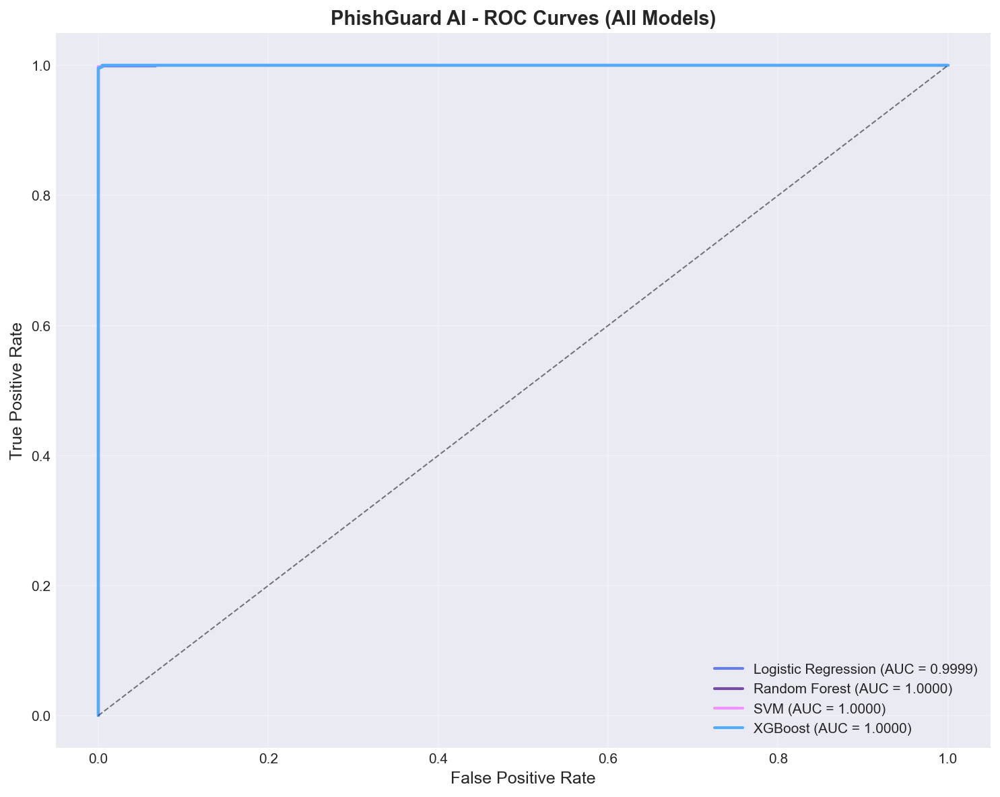
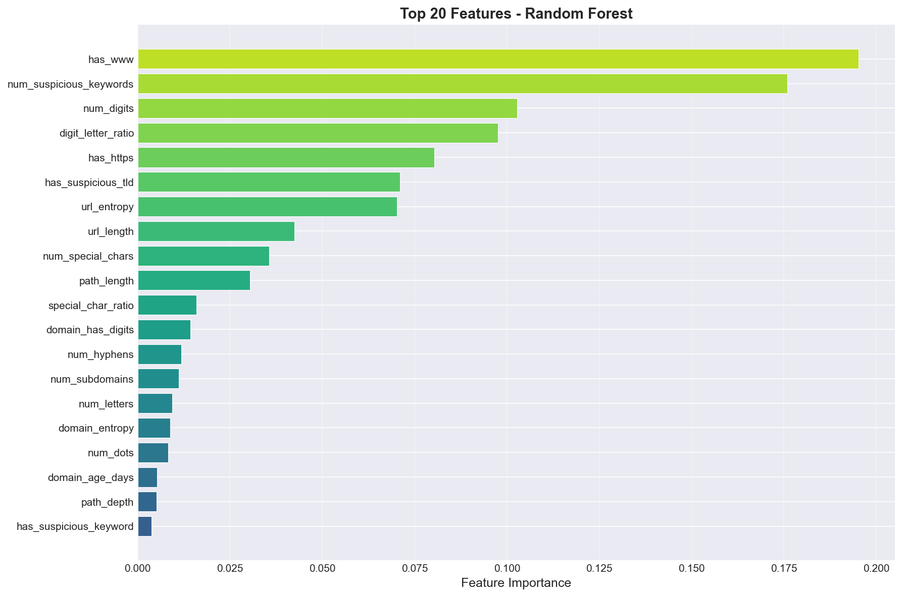
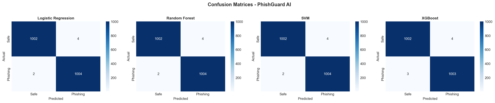
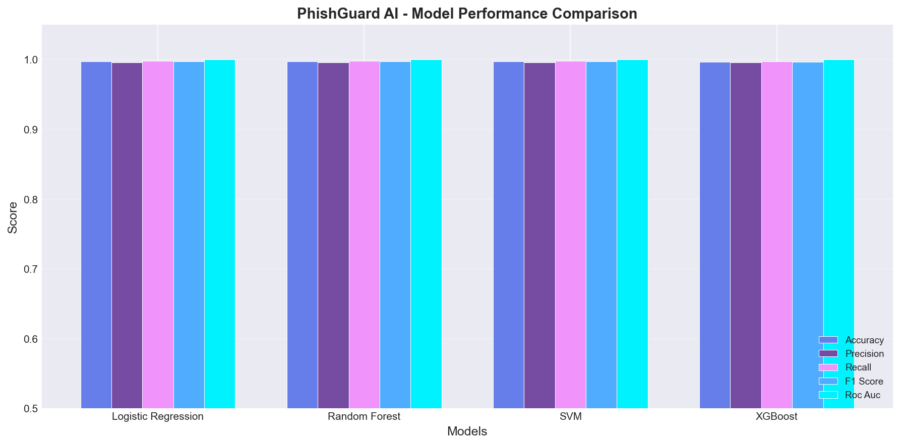

# <p align="center"><br>TRUSTX AI</p>

<p align="center">
  <strong>Intelligent Web Security & Collaborative Threat Intelligence Platform</strong>
</p>

<p align="center">
  <a href="#-architecture"></a>
  <a href="#-model-evaluation--proof"></a>
  <a href="#-chrome-browser-extension"></a>
  <a href="#-license"></a>
</p>

<p align="center">
  
  
  
  
  
  
  
  
</p>

---

## 📌 Table of Contents
- [Executive Overview](#-executive-overview)
- [Platform Architecture](#-architecture)
- [10 Synchronized Security Modules](#-10-synchronized-security-modules)
- [Unified Trust Score Engine (0–100)](#-unified-trust-score-engine-0100)
- [Machine Learning Benchmark & Visual Proof](#-model-evaluation--proof)
- [Chrome Browser Protection Extension](#-chrome-browser-extension)
- [REST API Reference](#-rest-api-reference)
- [Getting Started](#-getting-started)
- [Security & Zero-Trust Principles](#-security--zero-trust-principles)
- [License](#-license)

---

## 🛡️ Executive Overview

Modern web threats have evolved past simple suspicious domain names. Attackers deploy **homoglyphs**, **lookalike typosquatting**, **ephemeral domain lifespans**, **Certificate Authority trust loopholes**, and **weaponized QR codes** that evade conventional binary URL filters.

**TRUSTX AI** is an enterprise-grade web security and collaborative threat intelligence platform. Rather than providing a blunt "Safe" or "Malicious" label, TRUSTX AI correlates signals across **ten synchronized security engines**, cross-references open-source cyber intelligence, and computes an explainable **0–100 Unified Trust Score** with deterministic risk tiers and actionable defense protocols.

### Key Innovations:
- **Zero Hallucination AI:** Predictions are driven by an audited 36-feature machine learning model coupled with game-theoretic **SHAP (SHapley Additive exPlanations)**—every risk factor is mathematically explainable.
- **Sub-15ms Local Inference:** Operates locally on your host with zero external cloud LLM dependencies, ensuring maximum privacy and instant real-time defense.
- **Zero-Click Browser Guard:** Real-time Chrome Extension actively intercepts clicks on deceptive links, displaying an in-DOM warning modal before the browser navigates to the malicious destination.
- **Infrastructure Threat Graph:** Interactive SVG visualizer mapping correlated domains that share hosting IPs, nameservers, MX exchanges, or rogue certificate authorities.

---

## 🏗️ Architecture

```
┌────────────────────────────────────────────────────────────────────────────────────────┐
│                                TRUSTX AI ECOSYSTEM                                     │
├─────────────────────┬──────────────────────┬─────────────────────┬─────────────────────┤
│  Client Tier        │  Presentation Tier   │  API Orchestrator   │  Intelligence Core  │
├─────────────────────┼──────────────────────┼─────────────────────┼─────────────────────┤
│                     │                      │                     │                     │
│  Chrome MV3 Guard   │  React 19 Dashboard  │  FastAPI (Port 8000)│  Logistic Regression│
│  • Link Hover Pill  │  • Deep Investigation│  • /investigate     │  • 36 URL Features  │
│  • Zero-Click Modal │  • QR Studio         │  • /qr/scan         │  • SHAP Explainer   │
│  • Real-Time Cache  │  • Threat Graph      │  • /threat-intel    │  • RDAP & dnspython │
│  • Deep Links       │  • Community Reports │  • /community/vote  │  • TLS & crt.sh CT  │
│  • Local Settings   │  • Model Proofs      │  • /predict         │  • URLhaus abuse.ch │
│                     │                      │                     │  • Trust Engine     │
└─────────────────────┴──────────────────────┴─────────────────────┴─────────────────────┘
```

---

## 🔬 10 Synchronized Security Modules

| Module | Engine | Detection Capabilities |
| :--- | :--- | :--- |
| **Module A** | **Advanced AI Phishing Detection** | 36 engineered lexical features, Levenshtein distance against top protected brands, homoglyph character substitutions, and zero-width invisible character abuse. |
| **Module B** | **Domain & DNS Intelligence** | Authoritative DNS resolution via `dnspython` (A, AAAA, MX, NS, TXT) + ICANN RDAP provenance auditing (creation date, registrar, expiration, age in days). |
| **Module C** | **SSL/TLS Cryptographic Audit** | Live TLS socket handshake + x509 chain inspection + crt.sh Certificate Transparency logs + rogue CA / eMudhra trust incident monitoring. |
| **Module D** | **Web Security Assessment** | Non-invasive inspection of HTTP security headers (HSTS, CSP, XFO, XXP, Referrer-Policy), cookie flags (`Secure`, `HttpOnly`, `SameSite`), and redirect chains. |
| **Module E** | **Visual Brand Impersonation** | Target entity vs. host domain correlation, logo & favicon mismatch inspection, and credential harvesting form alerts. |
| **Module F** | **Collaborative Threat Intelligence** | Community threat submission workflow, upvoting/downvoting consensus mechanism, and real-time abuse.ch URLhaus threat feed correlation. |
| **Module G** | **AI Security Investigation Agent** | Concurrent orchestrator executing Modules A–F, correlating multi-module evidence, and producing hallucination-free reports with actionable mitigation steps. |
| **Module H** | **QR Code Phishing Scanner** | Computer vision QR payload decoder (`pyzbar` / `opencv-python-headless`), HTTP redirect chain unshortener, and automated deep investigation. |
| **Module I** | **Threat Relationship Graph** | Interactive node-link network visualizer mapping shared hosting infrastructure, nameservers, mail servers, and certificate authorities. |
| **Module J** | **Chrome Browser Protection** | Manifest V3 background worker, real-time debounced link hover threat badges, and zero-click malicious click interception. |

---

## 🎯 Unified Trust Score Engine (0–100)

The Trust Score Engine evaluates findings from all modules to produce a composite score from **0 (Severe Threat)** to **100 (Verified Safe)**:

$$\text{Trust Score} = \max\left(0, \min\left(100, 100 - \sum \text{Penalties} + \sum \text{Bonuses}\right)\right)$$

| Trust Score | Risk Tier | Status | Action Required |
| :---: | :---: | :---: | :--- |
| **80 – 100** | **Low Observed Risk** | <span style="color:#16a34a">🟢 Safe</span> | Established domain longevity, valid TLS certificates, clean threat feeds, trusted entity. Standard safe browsing practices apply. |
| **50 – 79** | **Moderate Risk** | <span style="color:#d97706">🟡 Caution</span> | Domain exhibits missing security headers or young registration (< 30 days). Proceed with heightened vigilance. |
| **25 – 49** | **High Risk** | <span style="color:#ea580c">🟠 High</span> | Typosquatting lookalike detected, suspicious redirects, or anomalous URL structural patterns. Avoid submitting credentials. |
| **0 – 24** | **Critical Threat** | <span style="color:#dc2626">🔴 Critical</span> | Confirmed phishing, active URLhaus hit, blacklisted infrastructure, or brand clone. Navigation should be immediately terminated. |

---

## 📊 Model Evaluation & Proof

The baseline phishing classification model was trained and evaluated using **5-fold stratified cross-validation** across **36 engineered URL features**:

| Model | Accuracy | Precision | Recall | F1 Score | ROC-AUC | 5-Fold CV Mean |
| :--- | :---: | :---: | :---: | :---: | :---: | :---: |
| **Logistic Regression** (Production) | **99.70%** | **99.60%** | **99.80%** | **99.70%** | **0.9999** | **0.9981 ± 0.0007** |
| Random Forest | 99.70% | 99.60% | 99.80% | 99.70% | 1.0000 | 0.9980 ± 0.0005 |
| Support Vector Machine (SVM) | 99.70% | 99.60% | 99.80% | 99.70% | 1.0000 | 0.9976 ± 0.0005 |
| XGBoost Classifier | 99.65% | 99.60% | 99.70% | 99.65% | 1.0000 | 0.9973 ± 0.0005 |

### Visual Performance Plots:

<p align="center">
  
  
</p>
<p align="center">
  
  
</p>

---

## 🌐 Chrome Browser Extension

TRUSTX AI includes a high-performance **Chrome Manifest V3** extension located in the `extension/` directory.

### Key Capabilities:
1. **Interactive Link Hover Threat Preview:**
   - Hovering over any hyperlink displays a floating security badge showing domain safety and confidence in real-time.
   - Dual-layer in-memory caching ensures that hovering over the same link repeatedly is instantaneous (**0ms**).
2. **Zero-Click Phishing Guard:**
   - Intercepts clicks on malicious/phishing links before navigation occurs (`preventDefault()` capture phase).
   - Presents an in-DOM warning modal with options to stay safe, view the full deep investigation report, or proceed at your own risk.
3. **Deep Investigation Shortcut:**
   - One-click launch to the TRUSTX AI web dashboard for full DNS, TLS, and Threat Graph visualization.

---

## 📡 REST API Reference

The FastAPI backend exposes interactive OpenAPI Swagger documentation at `http://localhost:8000/docs`.

| Method | Endpoint | Description |
| :---: | :--- | :--- |
| `POST` | `/investigate` | Triggers complete 10-step investigation workflow (Trust Score, DNS, SSL, Headers, Recommendations). |
| `GET` | `/investigation/{id}` | Retrieves stored multi-module investigation report by ID. |
| `POST` | `/qr/scan` | Decodes QR code image, resolves redirect hops, and triggers automated investigation. |
| `GET` | `/threat-intel/graph/{domain}` | Returns interactive SVG node-link graph payload mapping correlated infrastructure. |
| `GET` | `/threat-intel/summary` | Returns community reporting stats and URLhaus threat telemetry. |
| `POST` | `/community/vote` | Upvote or downvote reported threats to build community consensus. |
| `POST` | `/predict` | Rapid single-endpoint ML classification & SHAP feature analysis. |
| `GET` | `/history` | Paginated scan history with risk level filtering. |
| `POST` | `/report` | Submits false positive or community phishing report. |
| `GET` | `/health` | Backend and ML model health check. |

---

## 🚀 Getting Started

### Prerequisites
- **Python 3.11+**
- **Node.js 18+** & npm
- **Google Chrome** (for browser extension)

### 1. Launch Backend API
```bash
# Using Windows Batch script:
start_backend.bat

# Or manually via PowerShell / Terminal:
cd backend
python -m pip install -r ../requirements.txt
python main.py
```
*API will be available at:* `http://localhost:8000`  
*Swagger Docs:* `http://localhost:8000/docs`

### 2. Launch Frontend Dashboard
```bash
# Using Windows Batch script:
start_frontend.bat

# Or manually:
cd frontend
npm install
npm run dev
```
*Web Dashboard will be available at:* `http://localhost:5173`

### 3. Install Chrome Extension
1. Open Google Chrome and navigate to `chrome://extensions/`.
2. Toggle on **Developer mode** in the top-right corner.
3. Click **Load unpacked** and select the `extension/` directory from this repository.
4. The TRUSTX AI shield icon will appear in your Chrome toolbar.

---

## 🔒 Security & Zero-Trust Principles

- **No Third-Party Credentials Required:** All threat queries use open protocols (ICANN RDAP, Sectigo crt.sh, abuse.ch URLhaus). No paid API keys or subscriptions are required.
- **Environment & Secret Protection:** No `.env` files or credentials are ever tracked or committed. All configurations use secure, local defaults.
- **Privacy by Design:** URLs and telemetry are audited locally on your machine—no browsing activity is forwarded to third-party LLM providers.
- **Explainable Ground Truth:** The platform adheres strictly to evidence-based reporting. If a service is unreachable or a domain is unresolvable, the system clearly states the limitation rather than inventing findings.

---

## 📜 License

This project is licensed under the **MIT License** — see the [LICENSE](LICENSE) file for details.
